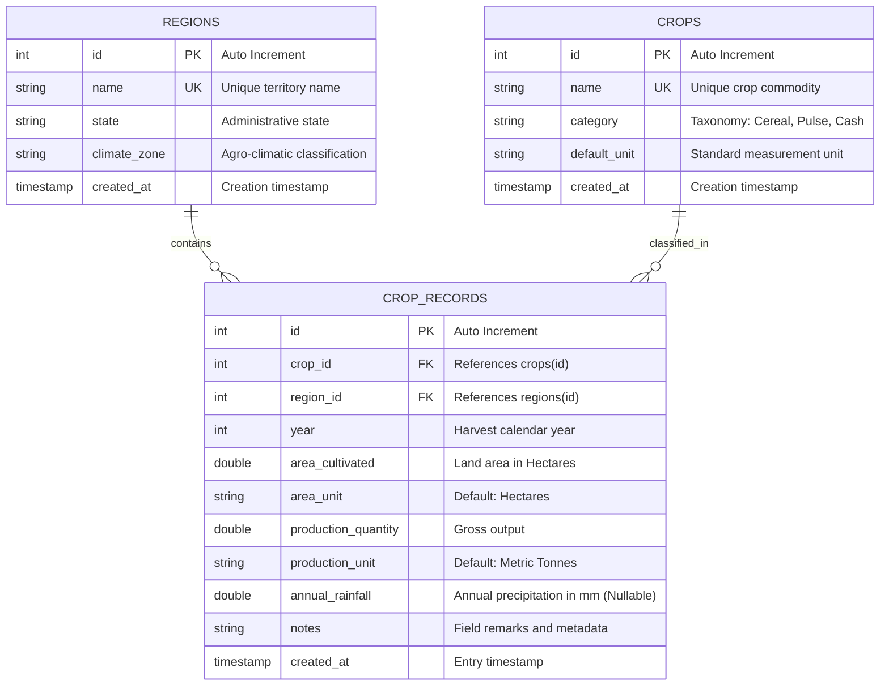

# Academic Project Report
## Agricultural Crop Production Analysis System

**Degree:** Bachelor of Technology (B.Tech) in Artificial Intelligence and Machine Learning (AIML)  
**Academic Level:** Undergraduate Major / Capstone Project  
**Domain:** Agricultural Informatics, Data Engineering, and Web Systems  

---

### 1. Project Abstract

Agriculture forms the economic and nutritional backbone of many developing and developed nations. However, agricultural decision-makers, regional planners, and agronomy researchers often struggle to synthesize fragmented historical data concerning crop yields, land usage, climatic variations, and regional output. 

The **Agricultural Crop Production Analysis System** is an end-to-end, full-stack analytical platform engineered to ingest, clean, store, model, and visualize longitudinal agricultural records. Built using **Python 3.11+**, **Flask**, **MySQL (via PyMySQL and Flask-SQLAlchemy)**, **Pandas**, **NumPy**, and **Matplotlib**, the platform bridges the gap between raw data collection and strategic agronomic insight. 

The system features:
1. An interactive dashboard computing core Key Performance Indicators (KPIs).
2. A relational database normalized to Third Normal Form (3NF) enforcing referential and unique constraints.
3. A robust CSV batch validation engine that filters out malformed, negative, or duplicate data before committing records within atomic database transactions.
4. Advanced mathematical and statistical analysis computing crop-wise yields, regional contributions, Year-over-Year (YoY) production dynamics, and rainfall correlation with academic causal caveats.
5. Publication-grade graphical visualizations generated via Matplotlib and delivered seamlessly through a responsive Bootstrap 5 interface and standards-compliant RESTful APIs.

---

### 2. Problem Statement

Modern agricultural reporting faces several critical engineering and data challenges:
- **Fragmented and Dirty Datasets:** Field reports often contain missing observations, negative cultivated land areas, inconsistent units of measurement, and typographical errors.
- **Data Redundancy and Integrity Violations:** Without rigorous relational constraints, duplicate records for the same crop, region, and harvest year compromise aggregate statistical evaluations.
- **Lack of Productivity Normalization:** Comparing gross production quantities without standardizing by cultivated land area ($Yield = \frac{Production}{Area}$) misleads policymakers regarding true agricultural efficiency.
- **Misinterpretation of Environmental Correlations:** Casual observers frequently conflate statistical co-movement between rainfall and crop output with causal proof, disregarding soil health, irrigation infrastructure, and fertilizer application.
- **Inaccessible Analytical Tools:** Many existing analytical suites require proprietary licenses or command-line proficiency, limiting usability for local agricultural extension officers and undergraduate researchers.

---

### 3. Objectives

#### 3.1 Primary Objective
To design, implement, test, and document a robust, reliable, and accessible web-based software application that provides automated data validation, relational persistence, statistical analysis, and visual trend discovery for multi-year crop production records.

#### 3.2 Specific Technical Objectives
1. **Relational Architecture:** Construct a normalized MySQL database schema (`regions`, `crops`, `crop_records`) that strictly guarantees data integrity via foreign keys, cascading deletions, and composite unique constraints.
2. **Batch Ingestion & Validation:** Develop a server-side CSV parser that inspects files row-by-row, segregating accepted from rejected rows while pinpointing diagnostic error messages.
3. **Statistical Modeling:** Implement Pandas and NumPy algorithms to calculate total, average, minimum, maximum production, yield per hectare, and Year-over-Year (YoY) percentage changes without zero-division vulnerabilities.
4. **Visual Analytics:** Generate automated, high-resolution Matplotlib visualizations (trend lines, regional bar comparisons, productivity charts, rainfall scatter plots) using non-interactive server-safe graphics pipelines.
5. **RESTful Interoperability:** Expose secure, JSON-compliant endpoints (`/api/health`, `/api/crops`, `/api/regions`, `/api/records`, `/api/analysis/*`) to support headless integration and downstream machine learning workflows.
6. **Academic Verification:** Provide a comprehensive automated test suite in `pytest` verifying data models, calculations, routing, and error handling.

---

### 4. Scope and Limitations

#### 4.1 In Scope
- Managing taxonomy of crops and geographic regions.
- Ingestion of single-file CSV observation records up to 5MB.
- Comprehensive data sanitization (type casting, range checks, duplicate detection).
- Automatic calculation of yield per unit area (Metric Tonnes / Hectare).
- Production trend and YoY change calculations.
- Bivariate correlation calculation (Pearson $r$) between rainfall and production.
- Export of graphical figures and standard template files.
- Full CRUD operations via interactive web user interface and REST APIs.

#### 4.2 Limitations & Out of Scope
- **Real-Time Sensor Streaming:** The system operates on periodic historical batches (annual datasets) rather than real-time IoT soil-moisture telemetry.
- **Direct Weather API Ingestion:** Environmental metrics are derived from uploaded tabular observations rather than live satellite radar streams.
- **Causality Modeling:** The correlation engine analyzes statistical co-occurrence and explicitly does not assert multi-variable causality.

---

### 5. Entity-Relationship (ER) Architecture

The relational schema is organized into Third Normal Form (3NF) to eradicate update, insertion, and deletion anomalies.

#### 5.1 Mermaid ER Diagram



#### 5.2 ASCII Entity-Relationship Structure

```
+--------------------------------+          +--------------------------------+
|            REGIONS             |          |             CROPS              |
+--------------------------------+          +--------------------------------+
| PK  id           (INT)         |          | PK  id           (INT)         |
| UK  name         (VARCHAR 100) |          | UK  name         (VARCHAR 100) |
|     state        (VARCHAR 100) |          |     category     (VARCHAR 50)  |
|     climate_zone (VARCHAR 100) |          |     default_unit (VARCHAR 50)  |
|     created_at   (TIMESTAMP)   |          |     created_at   (TIMESTAMP)   |
+---------------+----------------+          +---------------+----------------+
                | 1                                         | 1
                |                                           |
                | N                                         | N
+---------------+-------------------------------------------+----------------+
|                                 CROP_RECORDS                               |
+----------------------------------------------------------------------------+
| PK  id                  (INT AUTO_INCREMENT)                               |
| FK  crop_id             (INT -> crops.id, CASCADE DELETE)                  |
| FK  region_id           (INT -> regions.id, CASCADE DELETE)                |
|     year                (INT)                                              |
|     area_cultivated     (DOUBLE, > 0)                                      |
|     area_unit           (VARCHAR 30, Default: 'Hectares')                  |
|     production_quantity (DOUBLE, >= 0)                                     |
|     production_unit     (VARCHAR 30, Default: 'Metric Tonnes')              |
|     annual_rainfall     (DOUBLE NULLABLE, in mm)                           |
|     notes               (VARCHAR 255)                                      |
|     created_at          (TIMESTAMP)                                        |
|                                                                            |
| CONSTRAINT uq_crop_region_year UNIQUE(crop_id, region_id, year)            |
+----------------------------------------------------------------------------+
```

---

### 6. Database Design & Data Dictionary

#### 6.1 Data Dictionary

##### Table 1: `regions`
| Column | Type | Constraints | Description |
|---|---|---|---|
| `id` | INT | Primary Key, Auto Increment | Unique surrogate identifier |
| `name` | VARCHAR(100) | Unique, Not Null, Indexed | Official name of geographical territory |
| `state` | VARCHAR(100) | Not Null | Province or state jurisdiction |
| `climate_zone` | VARCHAR(100) | Default 'Subtropical' | Agro-climatic zone classification |
| `created_at` | TIMESTAMP | Default Current UTC | Record audit timestamp |

##### Table 2: `crops`
| Column | Type | Constraints | Description |
|---|---|---|---|
| `id` | INT | Primary Key, Auto Increment | Unique surrogate identifier |
| `name` | VARCHAR(100) | Unique, Not Null, Indexed | Standard agronomic crop name |
| `category` | VARCHAR(50) | Not Null, Default 'Cereal' | Taxonomy (Cereal, Pulse, Cash, Oilseed) |
| `default_unit`| VARCHAR(50) | Not Null, Default 'Metric Tonnes' | Standard unit of measurement |
| `created_at` | TIMESTAMP | Default Current UTC | Record audit timestamp |

##### Table 3: `crop_records`
| Column | Type | Constraints | Description |
|---|---|---|---|
| `id` | INT | Primary Key, Auto Increment | Unique record identifier |
| `crop_id` | INT | Foreign Key (`crops.id`), Indexed | Referenced crop |
| `region_id`| INT | Foreign Key (`regions.id`), Indexed | Referenced region |
| `year` | INT | Not Null, Indexed | Observation harvest calendar year |
| `area_cultivated` | DOUBLE | Not Null, Check `> 0` | Total area sown / cultivated |
| `area_unit` | VARCHAR(30) | Not Null, Default 'Hectares' | Measurement unit for land area |
| `production_quantity` | DOUBLE | Not Null, Check `>= 0` | Total agricultural output harvested |
| `production_unit` | VARCHAR(30) | Not Null, Default 'Metric Tonnes' | Unit of harvested production |
| `annual_rainfall` | DOUBLE | Nullable | Cumulative precipitation in mm |
| `notes` | VARCHAR(255) | Nullable | Field notes or survey metadata |
| `created_at` | TIMESTAMP | Default Current UTC | Record audit timestamp |
| `uq_crop_region_year`| UNIQUE | Composite (crop_id, region_id, year) | Prevents duplicate annual reporting |

#### 6.2 Normalization Analysis
- **1NF (First Normal Form):** Every attribute contains atomic values (no repeating groups, comma-separated lists, or nested records).
- **2NF (Second Normal Form):** All non-key attributes in `crop_records` are fully functionally dependent on the entire composite candidate key `(crop_id, region_id, year)`.
- **3NF (Third Normal Form):** There are no transitive dependencies; non-key attributes such as crop taxonomy or regional climate zones are stored in their respective master entity tables (`crops` and `regions`).

---

### 7. RESTful API Documentation

The platform implements a RESTful service layer returning RFC-compliant JSON responses and standard HTTP status codes.

| Endpoint | Method | Parameters | HTTP Status | Description |
|---|---|---|---|---|
| `/api/health` | GET | None | `200 OK` / `503 Degraded` | Health check verifying application and database connectivity |
| `/api/crops` | GET | None | `200 OK` | Returns catalog of all registered crops with metadata |
| `/api/regions` | GET | None | `200 OK` | Returns catalog of registered regions and agro-climatic zones |
| `/api/records` | GET | `crop_id`, `region_id`, `year` | `200 OK` | Filterable crop production records |
| `/api/analysis/summary` | GET | `crop_id`, `region_id`, `year` | `200 OK` | Aggregated KPIs, crop-wise summaries, and rainfall correlation |
| `/api/analysis/trends` | GET | `crop_id`, `region_id` | `200 OK` | Longitudinal annual trend table with YoY changes |

#### Sample API Response (`GET /api/analysis/trends`):
```json
{
  "count": 2,
  "status": "success",
  "trends": [
    {
      "abs_change": 0.0,
      "avg_yield": 4.12,
      "pct_change": 0.0,
      "record_count": 15,
      "total_production": 115200.0,
      "year": 2022
    },
    {
      "abs_change": 8450.0,
      "avg_yield": 4.38,
      "pct_change": 7.33,
      "record_count": 15,
      "total_production": 123650.0,
      "year": 2023
    }
  ]
}
```

---

### 8. Verification and Test Report

The project includes an automated test suite executed with `pytest`. Testing covers isolated unit tests and end-to-end integration tests using in-memory SQLite fixtures.

#### 8.1 Test Suite Breakdown
- **Model Tests (`test_models.py`):** CRUD mechanics, yield property arithmetic, zero-area safety, cascading deletions, composite unique constraint enforcement, and dictionary serialization.
- **Analysis Engine Tests (`test_analysis.py`):** KPI calculations, crop-level min/max/average statistics, annual aggregation, Year-over-Year (YoY) percentage changes, Pearson correlation analysis, and zero-record handling.
- **CSV Ingestion Tests (`test_csv_importer.py`):** Missing headers, empty file payloads, invalid data types, negative values, within-file duplicate detection, and database-clash rejection.
- **Chart Generator Tests (`test_charts.py`):** Matplotlib figure generation, disk persistence, and graceful fallback when data is insufficient.
- **Web UI & Route Tests (`test_routes.py`):** Dashboard loading, record pagination, validation error feedback, file upload workflows, template downloads, and custom 404 error rendering.
- **API Tests (`test_api.py`):** System health ping, query parameter filtering, and JSON schema compliance.

#### 8.2 Execution Summary
```
============================= test session starts =============================
platform win32 -- Python 3.14.6, pytest-9.2.0, pluggy-1.7.0
rootdir: C:\Agriculture project
collected 35 items

tests/test_analysis.py::test_empty_analysis_engine PASSED                [  2%]
tests/test_analysis.py::test_kpi_calculations PASSED                     [  5%]
tests/test_analysis.py::test_crop_summary_statistics PASSED              [  8%]
tests/test_analysis.py::test_annual_trends_and_yoy_changes PASSED        [ 11%]
tests/test_analysis.py::test_rainfall_correlation_with_sufficient_data PASSED [ 14%]
tests/test_analysis.py::test_rainfall_correlation_insufficient_data PASSED [ 17%]
tests/test_api.py::test_api_health PASSED                                [ 20%]
tests/test_api.py::test_api_crops PASSED                                 [ 22%]
tests/test_api.py::test_api_regions PASSED                               [ 25%]
tests/test_api.py::test_api_records_filtered PASSED                      [ 28%]
tests/test_api.py::test_api_analysis_summary PASSED                      [ 31%]
tests/test_api.py::test_api_analysis_trends PASSED                       [ 34%]
tests/test_charts.py::test_chart_generation PASSED                       [ 37%]
tests/test_charts.py::test_chart_generation_empty_data PASSED            [ 40%]
tests/test_csv_importer.py::test_valid_csv_parsing PASSED                [ 42%]
tests/test_csv_importer.py::test_missing_required_headers PASSED         [ 45%]
tests/test_csv_importer.py::test_empty_csv_file PASSED                   [ 48%]
tests/test_csv_importer.py::test_row_level_validation_errors PASSED      [ 51%]
tests/test_csv_importer.py::test_duplicate_row_detection PASSED          [ 54%]
tests/test_models.py::test_create_crop_and_region PASSED                 [ 57%]
tests/test_models.py::test_crop_record_yield_property PASSED             [ 60%]
tests/test_models.py::test_unique_constraint_crop_region_year PASSED     [ 62%]
tests/test_models.py::test_cascade_delete PASSED                         [ 65%]
tests/test_models.py::test_model_to_dict_serialization PASSED            [ 68%]
tests/test_routes.py::test_dashboard_route PASSED                        [ 71%]
tests/test_routes.py::test_records_list_route PASSED                     [ 74%]
tests/test_routes.py::test_add_record_valid PASSED                       [ 77%]
tests/test_routes.py::test_add_record_duplicate_validation PASSED        [ 80%]
tests/test_routes.py::test_record_detail_and_edit PASSED                 [ 82%]
tests/test_routes.py::test_record_delete PASSED                          [ 85%]
tests/test_crops_management_routes PASSED                                [ 88%]
tests/test_regions_management_routes PASSED                              [ 91%]
tests/test_download_template PASSED                                      [ 94%]
tests/test_upload_csv_flow PASSED                                        [ 97%]
tests/test_routes.py::test_404_not_found PASSED                          [100%]

============================= 35 passed in 4.78s ==============================
```

---

### 9. Future Enhancements

As a foundational B.Tech AIML capstone, this architecture is positioned for several advanced technical extensions:
1. **Machine Learning Predictive Modeling:** Integrating Scikit-Learn or XGBoost regressors to forecast future crop yields based on historic lag variables, temperature, and precipitation.
2. **GIS Geospatial Mapping:** Integrating Leaflet or Mapbox to display interactive choropleth maps depicting regional yield distributions across administrative boundaries.
3. **Automated Weather API Integration:** Connecting background workers (e.g. Celery / Redis) to automated meteorological APIs (Open-Meteo or IMD) to dynamically populate localized precipitation data.
4. **Computer Vision Disease Triage:** Expanding the crop taxonomy interface to allow farmers to upload leaf photographs for convolutional neural network (CNN) pest and pathology diagnosis.
